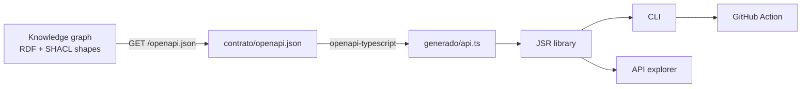

# ontology-client

**Live:** [API explorer](https://ontology.kiri231.com/explorador/) ·
[JSR package](https://jsr.io/@kiri23/ontology-client)

A TypeScript client generated from a [knowledge graph](docs/vocabulary/knowledge-graph.md). The graph lives on a server,
ontologyLearning, where a set of [rules](docs/vocabulary/shacl-shape.md) defines each class. The server publishes those
rules as an [OpenAPI contract](docs/vocabulary/openapi-contract.md), and this repo turns that contract into a JSR
library, a CLI and a GitHub Action. Nobody writes the types by hand.

> **0.x:** the API is not stable yet. A minor version can break it: pin the exact version.


A class in the graph becomes nodes and edges, a TypeScript type, a module of the SDK and a call the editor completes.
`Book` is a stand-in for the graph's own classes. [Video with narration](docs/media/readme.mp4)
([subtitles](docs/media/readme.srt)) · [scenes](docs/media/escenas/readme.py) · regenerate with
`bash docs/media/escenas/generar.sh`.

## The problem

A [knowledge graph](docs/vocabulary/knowledge-graph.md) is a good way to store connected data, but it's hard to use from
everyday code. You query it with a language of its own ([SPARQL](docs/vocabulary/sparql.md)), the results come back
without types, and your editor has no idea what's inside. So every app, CI check or chart built on the graph starts the
same way: someone works out its shape again, by hand.

ontology-client turns the graph into code. Its classes become TypeScript types and functions you can call, so the graph
can be queried from code, checked in CI, and drawn in a browser. When the graph gains a class, the client gains its
type.

## Results

- **Install it and your editor knows the graph.** One import from JSR, and every class in the
  [knowledge graph](docs/vocabulary/knowledge-graph.md) shows up with autocomplete and type checks.
- **Try every function without installing anything.** The [API explorer](https://ontology.kiri231.com/explorador/) runs
  each function against the live server, with a form for its inputs. A test fails if someone adds a function and forgets
  its demo.
- **See the graph.** The explorer downloads the whole graph and draws it as nodes and edges you can click.
- **Catch bad data before it merges.** A GitHub Action checks data files against the graph's
  [rules](docs/vocabulary/shacl-shape.md) on every pull request and flags the files that break them. It already guards
  another repo.
- **Swap the database, keep the code.** The same calls read from the server or from a Neo4j copy, and a test checks that
  both return the same answer.

## How it's built



The server turns its [SHACL shapes](docs/vocabulary/shacl-shape.md) into an
[OpenAPI](docs/vocabulary/openapi-contract.md) 3.1 contract. This repo keeps a copy in `contrato/` and generates
`generado/api.ts` from it. Both are committed and never edited by hand. CI fails if the generated types don't match the
contract. When the server changes, refreshing the contract and running the type checker shows every call that no longer
fits.

| Layer           | Technology                                                                                                              |
| --------------- | ----------------------------------------------------------------------------------------------------------------------- |
| Source of truth | A knowledge graph in [RDF](docs/vocabulary/rdf.md) with SHACL shapes, served by ontologyLearning                        |
| Types           | openapi-typescript, regenerated with `deno task generar`                                                                |
| HTTP            | openapi-fetch, exposed as-is through `crearCliente()` instead of hidden behind a wrapper                                |
| Backends        | HTTP by default, or a read-only Neo4j view through `neo4j-driver` in a separate entry point                             |
| Package         | Deno, published to JSR from GitHub Actions with OIDC (no stored token)                                                  |
| CLI and Action  | One `cli.ts`; the Action is a composite action that pins its Deno version                                               |
| Explorer        | Vite + React, with Oxigraph (SPARQL in the browser) and Cytoscape, shipped as a Docker image behind a shared Caddy edge |
| Docs            | A [Turtle](docs/vocabulary/turtle.md) vocabulary rendered to markdown with n3, checked in CI                            |

## Run it locally

**Use it without cloning.** With [Deno](https://deno.com) (CI uses 2.9.5), this counts the facts in the live graph:

```ts
import { sparql } from "jsr:@kiri23/ontology-client";

const { texto } = await sparql.consultar("SELECT (COUNT(*) AS ?n) WHERE { ?s ?p ?o }");
console.log(texto);
```

**Work on the repo.**

```sh
git clone https://github.com/Kiri23/ontology-client.git
cd ontology-client
deno task hola    # hello world: what the live graph holds right now
deno task test
deno task hooks   # optional: runs the CI checks before every commit
```

`deno task hola` prints something like this (the numbers and classes are whatever the graph holds when you run it):

```
The graph has 1279 facts (triples).

Domain classes, by number of instances (top 6 of 6):
    131  JobPost     https://kiri23.dev/jobs#JobPost
     43  Uso         https://kiri23.dev/catalogo#Uso
     21  Workflow    https://kiri23.dev/catalogo#Workflow
…
```

**Run the explorer.** It needs Node 24:

```sh
cd explorador
npm ci
npm run dev       # http://localhost:5173/explorador/
```

The dev server sends API calls to the live server, so anything you run from it behaves like the published page.

## Commands

| Command                              | What it does                                                                           |
| ------------------------------------ | -------------------------------------------------------------------------------------- |
| `deno task hola`                     | Prints what the live graph holds: facts, classes, one instance                         |
| `deno task test`                     | Runs the test suite                                                                    |
| `deno task contrato`                 | Downloads the server's OpenAPI contract into `contrato/`                               |
| `deno task generar`                  | Regenerates the types from the contract; `--check` fails if they're stale              |
| `deno task vocabulario`              | Renders the vocabulary into `docs/vocabulary/`; `--check` fails if it's stale          |
| `deno task hooks`                    | Installs a pre-commit hook that runs the CI checks                                     |
| `deno task neo4j:cargar`             | Rebuilds the Neo4j copy from the live graph (needs `NEO4J_URL` and `NEO4J_PASSWORD`)   |
| `bash docs/media/escenas/generar.sh` | Re-renders the README animation with [ManimGX](https://manimgx.academa.ai/) and ffmpeg |

The CLI and the GitHub Action check Turtle files against the graph's rules:

```sh
deno run --allow-net --allow-read --allow-env jsr:@kiri23/ontology-client@0.1.2/cli <files>
```

```yaml
- uses: Kiri23/ontology-client@v0
  with:
    token: ${{ secrets.ONTOLOGY_PROYECTOS_TOKEN }}
```

Every option is in [docs/](docs/README.md): the [library](docs/library.md), [engines](docs/engines.md), the
[CLI](docs/cli.md), the [Action](docs/action.md) and [development](docs/development.md).

## Limitations

- **Only the types are generated.** The functions for each class are still written by hand on top of the generated
  types, so a new class gets its type right away and its functions only when someone writes them.
- **The client is tied to one server and its classes.** It defaults to a single server URL, and its hand-written modules
  name that server's classes. The goal is a client that learns everything it needs from the contract, with no server or
  domain built in.
- **TypeScript only.** The contract could feed generators for other languages, but none exist yet.

## License

MIT
